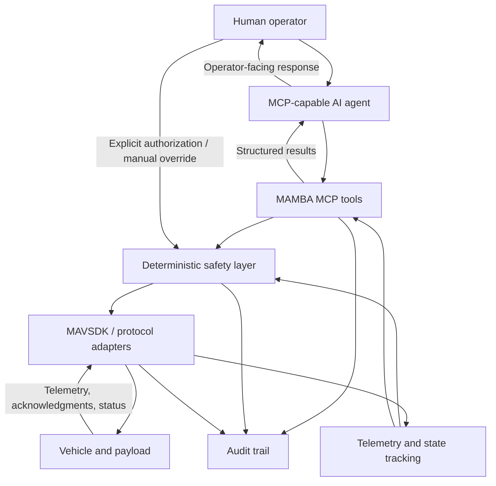

# Planned Architecture

Source: proposal §2 and §4. No components or interfaces are implemented. This document describes responsibilities, not public APIs or wire schemas.

## Command and information flow

## Component boundaries

| Planned area | Responsibility |
| --- | --- |
| MCP tools | Discoverable semantic operations, argument validation, structured results, and controlled errors; no low-level message construction |
| Safety | Platform/payload state evaluation, authorization, sequencing, rate/timing limits, and manual-override precedence |
| Adapters | Persistent vehicle connectivity, MAVSDK integration, protocol translation, and controlled connection/SDK failures |
| Telemetry | Independent vehicle observations, connection status, freshness, and state evidence available to tools and safety |
| Operator integration | Natural-language input, agent responses, telemetry/status, notifications, approvals, and manual-control status; UI technology TBD |
| Audit | Chronological request, safety-decision, execution-result, and authorization evidence; detectable logging failures |

## State and concurrency

Each vehicle needs a unique identifier and independent connection, telemetry, safety state, sequencing, and authorization context. Payload state is associated with its host vehicle. Concurrent requests must not mix destinations or allow conflicting state-changing operations on one vehicle. One vehicle disconnecting must not interrupt another.

Vehicle and payload state is derived from telemetry and system information, not assumed from an agent request or command submission. Unknown, stale, or inconsistent required state prevents execution. The exact freshness policy, synchronization method, queueing behavior, and completion criteria remain decisions in the [decision register](decisions.md).

## Extension boundaries

Keep platform-specific operating envelopes and state definitions configuration-driven, with requirements validated alongside the customer and subject matter experts. UAV, USV, and UGV models share infrastructure without imposing airborne states on surface/ground vehicles.

MAVLink-M starts as an abstraction/stub and representative simulation integration. The dialect/version, discovery/addressing, and MAVSDK extension mechanism are unresolved. Do not claim actual SDK or hardware support from the proposal alone.

## Tool documentation required during implementation

For each actual tool, document purpose, inputs and units, target selection, output, associated MAVSDK capability, supported platforms, required state, authorization, completion behavior, errors, and limitations. Tool names, schemas, and the final catalog remain TBD; candidate advanced capabilities in the proposal are not committed interfaces.
